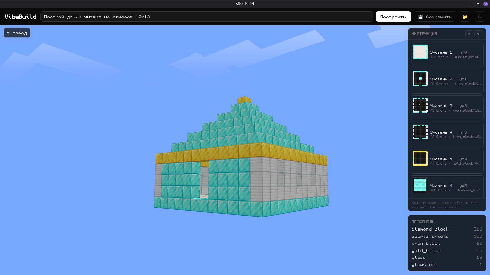
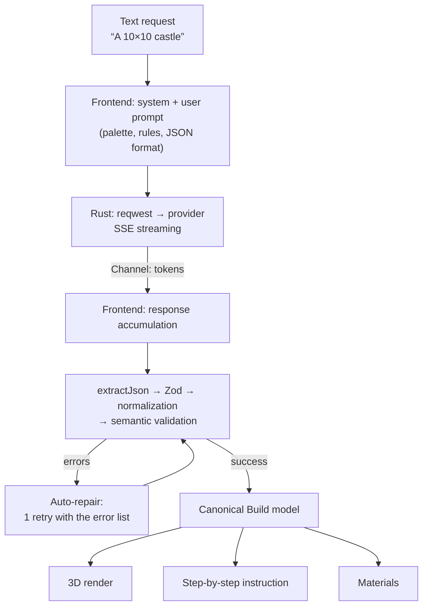

<div align="center">
  

  # VibeBuild

  **Generate Minecraft builds with an LLM.**

  **English** | [Русский](README.ru.md)

  A Tauri 2 desktop app: you type a request, an LLM returns the build as
  layer-by-layer 2D grids, the app validates the response, renders the build in 3D (Three.js)
  and produces a step-by-step instruction with a bill of materials for building it in real Minecraft.

     

  
  
</div>

## Features

- **Text-to-build generation** — “A 10×10 castle”, “A wizard tower”… builds up to 24×24×24 blocks
- **Real-time streaming** + a Stop button (the provider connection closes immediately, no tokens wasted)
- **Auto-repair**: if the model replied with invalid JSON, the app automatically asks it once more, passing the exact list of errors
- **3D viewport**: sky with procedural clouds, orbit camera, per-face textures (logs with end-grain tops, green grass top), translucent blocks
- **Step-by-step instructions**: layer by layer, bottom-up, a 2D blueprint of each layer drawn from the atlas, layer focus in 3D (current layer is lit, below — ghost, above — hidden), ←→/Esc navigation
- **Materials**: the full bill of materials of the build
- **Two interface languages** (Russian / English) — switched in the provider settings dialog; the LLM prompt is always English
- **Saved builds**: builds live in the OS config directory, a “My builds” menu (open/delete); localStorage in browser dev mode
- **Bring-your-own API key**: OpenAI-compatible providers (OpenAI, DeepSeek, OpenRouter, vLLM, local Ollama) and Anthropic; the key is stored locally and never leaves your machine except to your LLM provider

## How it works



---

## Interaction with LLM

### What the app sends to the provider

The request consists of two messages — `system` and `user`.

**The system prompt** is always English (models follow it most reliably) and sets the role plus a strict format:

> You are a Minecraft build generator. You return ONLY a JSON object — no explanations, no markdown.

It includes four blocks:

1. **Response format** — JSON with an array of layers: `{ "name": "...", "layers": [{ "y": 0, "rows": [".....", "..AAA"] }] }`.
2. **Nine rules**:
   - a layer is a horizontal slice at height `y`; `y` starts at 0 (the ground) and grows upward **with no gaps**;
   - a string is a row along depth (z), a character is a block along width (x), row 0 is the north side;
   - one character = one block, `.` = air;
   - use **only palette characters**;
   - all rows of a layer are the same length, all layers have the same width and depth;
   - the 24×24×24 limit, 8–16 blocks in width/depth is optimal;
   - the bottom layer is the foundation/floor; every block rests on the block below it (no “floating” blocks);
   - make the build hollow inside where appropriate, leave door and window openings;
   - artistic taste: combine materials, add cornices, columns, roofs, windows.
3. **The palette** — a fixed `character = block` table (73 vanilla cube blocks: planks, logs, stones/bricks, glass, wool, concrete, etc.). Character assignment is stable and defined by the whitelist order in `scripts/palette-config.mjs`:
   ```text
   A = stone        B = cobblestone   C = mossy_cobblestone
   D = stone_bricks …
   . = air
   ```
4. **A few-shot example** — the full correct JSON of the demo 5×5 house. The example is generated from the same fixture the renderer draws (`src/lib/build/demo.ts`), so the prompt cannot desync from the code.

**The user prompt** — the user's request plus a reminder about the limit:

```text
User request: «A 10×10 castle»
Generate a build following the format from the instructions. Remember the 24×24×24 limit.
```

### What the app expects to receive

The model must return **a JSON object only**. Expected shape:

```json
{
  "name": "Small house",
  "layers": [
    { "y": 0, "rows": ["AAAAA", "ABBBA", "ABBBA", "ABBBA", "AAAAA"] },
    { "y": 1, "rows": ["AAAAA", "A...A", "A...A", "A...A", "AAAAA"] },
    { "y": 2, "rows": ["AAAAA", "A...A", "A...A", "A...A", "AAAAA"] }
  ]
}
```

- `y` — the layer height, starting at 0, no gaps;
- each string in `rows` is a horizontal row of the layer: string = z (depth), position in the string = x (width), row 0 = north;
- characters are strictly from the palette, `.` is air;
- the app does not even ask for the `size` field and does not trust declared sizes — it computes them (see below).

**Why palette codes instead of full block names?** Compactness: grids of single-character codes are 3–5× shorter than full names — this directly reduces the risk of hitting the model's output limit on 24³ builds. And most importantly, inventing a non-existent block becomes nearly impossible: any character outside the dictionary is caught by the validator.

---

## How the response is processed: the full pipeline

The response's path from SSE bytes to the 3D scene. The logic is deliberately split into pure functions with unit tests (`yarn test`).

### 1. Streaming (Rust → webview)

The provider request is performed by **Rust**. OpenAI-compatible providers — `POST /chat/completions` with `stream: true` (the delta comes from `choices[0].delta.content`), Anthropic — `POST /v1/messages` with `stream: true` (`content_block_delta` / `text_delta` events). Tokens travel to the webview via a `tauri::ipc::Channel`; the UI shows a character counter. Generation can be stopped: the id is registered in a cancellation registry, dropping the stream closes the HTTP connection.

Errors arrive as a `{ kind, message }` structure: `network` (no connection/timeout), `http` (status + URL) or `protocol` (malformed SSE frame). Based on `kind`, the UI picks a plain-language hint (“check the key and base URL in Settings” for 401/403, etc.).

### 2. JSON extraction — `extractJson()`

Models love wrapping the response in ```json fences or adding chatter around it. The extractor cuts the substring **from the first `{` to the last `}`** and tolerates any fences/chatter around. If no `{`…`}` is found — the error “No JSON object found in the model response”.

### 3. Schema (Zod)

```ts
{ name?: string, size?: { width, height, depth }, layers: [{ y: int ≥ 0, rows?: string[], grid?: string[][] }] }
```

- `name` and `size` are optional — a missing name is cured by a default, a missing `size` does not hurt;
- `rows` — an array of **code strings** (the primary format), `grid` — an array of arrays of cells (the second accepted format; saved builds load through it too).

### 4. Cell normalization

Every cell is reduced to a block id:

- one character → a palette code (`A` → `stone`);
- a longer string → a **block name**: `trim()`, lowercase, spaces → `_` (`" Oak Planks "` → `oak_planks`); `air` is air;
- an empty cell → an error with exact coordinates (layer, row, position).

An unknown code or an unknown block → an error like `Layer y=3, row 2, position 7: unknown symbol "Ω" — use only palette symbols or "." for air`.

### 5. Geometry is computed from the grids

The build's dimensions are **derived from the data, not from the model's words**:

- `width` / `depth` — the maxima of row lengths across all layers (short rows are padded with air + a warning);
- `height` = the maximum `y` + 1;
- missing `y` layers (gaps) are filled with air + a warning;
- if the model declared a `size` that does not match the actual one — a warning (“using the actual one”);
- exceeding 24³ — a warning, not an error.

This way an “LLM that confidently declared 10×10 but drew 14×9” does not break the render — and is honestly reported to the user.

### 6. Auto-repair — one retry

If the first check produced errors, the app **itself** sends a repair request: the same model receives the list of errors with coordinates and the previous response truncated to 4000 characters:

```text
Your previous response contained errors. Fix them and return the corrected JSON in full.
Errors:
1. Layer y=2, row 4: unknown symbol "Ω"…
Previous response:
{ … }
```

A second failure in a row — the error screen (text + hints + “Copy” + “Try again”). Success — the canonical model.

### 7. Canonical model → render, instruction, materials

```ts
type Build = {
  name: string;
  size: { width: number; height: number; depth: number }; // width=X, height=Y, depth=Z
  layers: { y: number; rows: BlockId[][] }[];             // rows = Z, columns = X, row 0 = north
};
```

This is the single source of truth: it feeds the merged BufferGeometry with face culling and per-face UVs from the atlas (neighbors “inside” the build are culled; in focus mode the layers above the focus are treated as air, otherwise the slice would “eat” the faces), the step-by-step instruction (a step = a non-empty layer, bottom-up; the step preview is drawn with south tiles from the atlas) and the bill of materials.

---

## Providers and keys

| | |
|---|---|
| OpenAI-compatible | OpenAI, DeepSeek, OpenRouter, vLLM, Ollama — one client, configurable base URL |
| Anthropic | a separate adapter (`/v1/messages`) |
| Key | entered in ⚙, stored in the OS config directory's `settings.json` with 0600 permissions; requests go from the Rust process |
| Local | Ollama — base URL `http://localhost:11434/v1`, the key can be left empty |

## Development

Requirements: Node 24 (the scripts run on type-stripping), Rust (stable), yarn 1.22.

```bash
yarn install
node scripts/fetch-textures.mjs   # downloads 82 PNG textures from PrismarineJS/minecraft-assets (26.1) into json assets/blocks/
node scripts/build-palette.mjs    # builds src/assets/palette.json + atlas.png
yarn tauri dev                    # run the app (invoke only works inside Tauri)
```

Other commands:

| Command | What it does |
|---|---|
| `yarn test` | unit tests of validation and instructions (18 cases) |
| `yarn build` | types + production build of the web part |
| `node scripts/make-icon.mjs` | regenerate the icon (SVG + PNG source) |
| `yarn tauri icon src/assets/app-icon.png` | regenerate the OS icon set from the source |
| `node scripts/check-winding.mjs` / `check-geometry.mjs` | render regression checks (winding, culling, UVs, focus-layer slice) |

Without a configured provider (or in a plain browser without Tauri) the app runs in **demo mode**: it draws the fixture house; `?demo` in the URL — instantly.

## Project structure

<details>
<summary>Tree (click)</summary>

```
src/
  lib/palette/      palette.ts (block catalog + faceTile), prompt.ts (system/user/repair, English)
  lib/build/        types.ts (Build), validate.ts (the pipeline above), instructions.ts, demo.ts
  lib/render/       faceTable.ts (6 faces), voxelGeometry.ts (per-face UV, culling), VoxelScene.ts
  lib/llm/          client.ts (invoke + Channel, typed errors)
  lib/storage.ts    saved builds (Tauri config dir / localStorage)
  lib/i18n.ts       ru/en dictionaries + language store; useLang.ts — React hook
  components/       Viewer3D, StepsPanel, LayerPreview, SettingsDialog, SavedBuildsDialog
  App.tsx           phases idle|generating|ready|error, generate() with auto-repair
src-tauri/src/
  llm.rs            SSE streaming, cancellation registry
  settings.rs       settings storage incl. UI language (0600)
  builds.rs         saved builds
scripts/            palette/assets/icon/checks
tests/              node --test: validation + instructions
```

</details>
