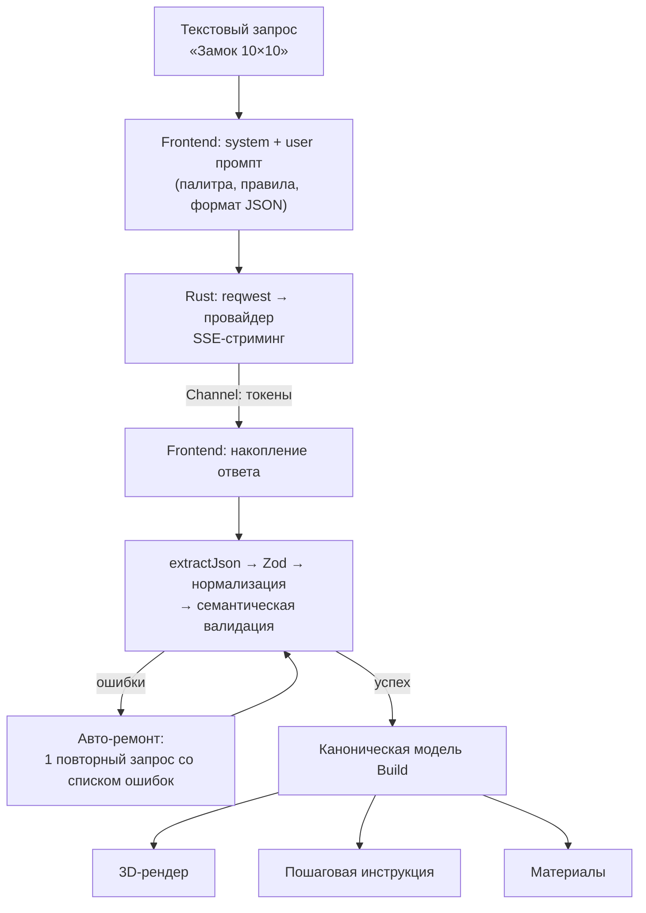

<div align="center">
  

  # VibeBuild

  **Генерируйте майнкрафт постройки при помощи LLM.**

  Десктоп-приложение на Tauri 2: текстовый запрос уходит в LLM, модель возвращает постройку
  послойными 2D-сетками, приложение валидирует ответ, рендерит постройку в 3D (Three.js)
  и выдаёт пошаговую инструкцию с материалами для стройки в настоящем Minecraft.

      

  
  
</div>

## Возможности

- **Генерация по текстовому описанию** — «Замок 10×10», «Башня волшебника»… постройки до 24×24×24 блоков
- **Стриминг** ответа в реальном времени + кнопка «Остановить» (соединение с провайдером закрывается сразу, токены не расходуются)
- **Авто-ремонт**: если модель ответила невалидным JSON — приложение один раз автоматически переспрашивает её, передав конкретный список ошибок
- **3D-вьюпорт**: небо с процедурными облаками, орбитальная камера, текстуры по граням (брёвна с торцами, зелёный верх травы), полупрозрачные блоки
- **Пошаговая инструкция**: слой за слоем снизу вверх, 2D-чертёж каждого слоя из атласа, фокус слоя в 3D (текущий слой ярко, ниже — ghost, выше — скрыто), навигация ←→/Esc
- **Материалы**: полный bill of materials постройки
- **Сохранения**: постройки хранятся в каталоге конфигурации, меню «Мои постройки» (открыть/удалить); в браузерном dev-режиме — localStorage
- **Bring-your-own API key**: OpenAI-совместимые провайдеры (OpenAI, DeepSeek, OpenRouter, vLLM, локальный Ollama) и Anthropic; ключ хранится локально и не уходит никуда, кроме вашего llm провайдера

## Как это работает



---

## Контракт с LLM

### Что программа отправляет провайдеру

Запрос состоит из двух сообщений — `system` и `user`.

**System prompt** задаёт роль и жёсткий формат:

> Ты — генератор построек для Minecraft. Ты возвращаешь ТОЛЬКО JSON-объект без пояснений, без markdown-разметки.

и включает четыре блока:

1. **Формат ответа** — JSON с массивом слоёв: `{ "name": "...", "layers": [{ "y": 0, "rows": [".....", "..AAA"] }] }`.
2. **Девять правил**:
   - слой — горизонтальный срез на высоте `y`; `y` начинается с 0 (земля) и растёт вверх **без пропусков**;
   - строка = ряд по глубине (z), символ = блок по ширине (x), строка 0 — северная сторона;
   - один символ = один блок, `.` = воздух;
   - использовать **только символы палитры**;
   - все строки слоя одной длины, все слои — одинаковые ширина и глубина;
   - лимит 24×24×24, оптимум 8–16 блоков по ширине/глубине;
   - нижний слой — фундамент/пол; каждый блок опирается на блок под ним (никаких «висящих» блоков);
   - делать постройку полой внутри, где уместно, оставлять проёмы дверей и окон;
   - художественный вкус: сочетать материалы, добавлять карнизы, колонны, крыши, окна.
3. **Палитра** — фиксированная таблица `символ = блок` (73 ванильных блока-куба: доски, брёвна, камни/кирпичи, стекло, шерсть, бетон и т.д.). Присвоение символов стабильно и определяется порядком whitelist в `scripts/palette-config.mjs`:
   ```text
   A = stone        B = cobblestone   C = mossy_cobblestone
   D = stone_bricks …
   . = воздух
   ```
4. **Few-shot пример** — полный корректный JSON демо-домика 5×5. Пример генерируется из той же фикстуры, которой соответствует рендер (`src/lib/build/demo.ts`), поэтому промпт не может рассинхронизироваться с кодом.

**User prompt** — запрос пользователя плюс напоминание о лимите:

```text
Запрос пользователя: «Замок 10×10»
Сгенерируй постройку по формату из инструкции. Помни про лимит 24×24×24.
```

### Что программа ожидает получить

Модель обязана вернуть **только JSON-объект**. Ожидаемая форма:

```json
{
  "name": "Маленький домик",
  "layers": [
    { "y": 0, "rows": ["AAAAA", "ABBBA", "ABBBA", "ABBBA", "AAAAA"] },
    { "y": 1, "rows": ["AAAAA", "A...A", "A...A", "A...A", "AAAAA"] },
    { "y": 2, "rows": ["AAAAA", "A...A", "A...A", "A...A", "AAAAA"] }
  ]
}
```

- `y` — высота слоя, начиная с 0, без лакун;
- каждая строка в `rows` — горизонтальный ряд слоя: строка = z (глубина), позиция в строке = x (ширина), строка 0 = север;
- символы — строго из палитры, `.` — воздух;
- поле `size` программа вообще не просит и не доверяет заявленным размерам — она их вычисляет (см. ниже).

**Почему палитра-коды, а не полные имена блоков?** Компактность: сетки из односимвольных кодов в 3–5 раз короче полных имён — это напрямую снижает риск упереться в лимит вывода модели на постройках 24³. И главное — выдумать несуществующий блок становится почти невозможно: любой символ вне словаря ловится валидатором.

---

## Как обрабатывается ответ: полный пайплайн

Путь ответа от байтов SSE до 3D-сцены. Логика сознательно разложена на чистые функции с юнит-тестами (`yarn test`).

### 1. Стриминг (Rust → webview)

Запрос к провайдеру выполняет **Rust**. OpenAI-совместимые провайдеры — `POST /chat/completions` с `stream: true` (дельта берётся из `choices[0].delta.content`), Anthropic — `POST /v1/messages` с `stream: true` (события `content_block_delta` / `text_delta`). Токены летят в webview через `tauri::ipc::Channel`; UI показывает счётчик символов. Генерацию можно остановить: идентификатор регистрируется в реестре отмены, дроп стрима закрывает HTTP-соединение.

Ошибки приходят структурой `{ kind, message }`: `network` (нет соединения/таймаут), `http` (статус + URL) или `protocol` (битый SSE-кадр). По `kind` UI подбирает человеческую подсказку («проверьте ключ и base URL в настройках» для 401/403 и т.п.).

### 2. Извлечение JSON — `extractJson()`

Модели любят оборачивать ответ в ```json-заборы или добавлять комментарии вокруг. Извлекатель вырезает подстроку **от первого `{` до последнего `}`** и терпит любые заборы/болтовню вокруг. Если `{`…`}` не найдено — ошибка «В ответе модели не найден JSON-объект».

### 3. Схема (Zod)

```ts
{ name?: string, size?: { width, height, depth }, layers: [{ y: int ≥ 0, rows?: string[], grid?: string[][] }] }
```

- `name` и `size` опциональны — отсутствие названия лечится дефолтом, отсутствие `size` не мешает;
- `rows` — массив **строк-кодов** (основной формат), `grid` — массив массивов ячеек (второй допустимый формат, им же загружаются сохранённые постройки).

### 4. Нормализация ячеек

Каждая ячейка приводится к id блока:

- один символ → код палитры (`A` → `stone`);
- длинная строка → **имя блока**: `trim()`, нижний регистр, пробелы → `_` (`" Oak Planks "` → `oak_planks`); `air` — воздух;
- пустая ячейка → ошибка с точными координатами (слой, строка, позиция).

Неизвестный код или неизвестный блок → ошибка вида `Слой y=3, строка 2, позиция 7: неизвестный символ "Ω" — используй только символы из палитры`.

### 5. Геометрия вычисляется из грид

Размеры постройки **выводятся из данных, а не из слов модели**:

- `width` / `depth` — максимумы длин строк по всем слоям (короткие строки дополняются воздухом + warning);
- `height` = максимальный `y` + 1;
- пропущенные слои `y` (лакуны) заполняются воздухом + warning;
- если модель заявила `size`, не совпавший с фактическим — warning «используется фактический»;
- превышение 24³ — warning, не ошибка.

Так «LLM, которая уверенно заявила 10×10, но нарисовала 14×9», не ломает рендер — а честно рапортуется пользователю.

### 6. Авто-ремонт — один повторный запрос

Если после первой проверки есть ошибки, приложение **само** отправляет repair-запрос: той же модели возвращают список ошибок с координатами и обрезанный до 4000 символов предыдущий ответ:

```text
Твой предыдущий ответ содержал ошибки. Исправь их и верни исправленный JSON целиком.
Ошибки:
1. Слой y=2, строка 4: неизвестный символ "Ω"…
Предыдущий ответ:
{ … }
```

Второй фейл подряд — экран ошибки (текст + подсказки + «Скопировать» + «Попробовать снова»). Успех — каноническая модель.

### 7. Каноническая модель → рендер, инструкция, материалы

```ts
type Build = {
  name: string;
  size: { width: number; height: number; depth: number }; // width=X, height=Y, depth=Z
  layers: { y: number; rows: BlockId[][] }[];             // rows = Z, колонки = X, строка 0 = север
};
```

Это единый источник истины: из него строится merged BufferGeometry с face culling и per-face UV из атласа (кулинг соседей «внутри» постройки; в фокус-режиме слои выше фокуса считаются воздухом, иначе срез «проедал» грани), пошаговая инструкция (шаг = непустой слой снизу вверх, шаг-превью рисуется тайлами юга из атласа) и bill of materials.

---

## Провайдеры и ключи

| | |
|---|---|
| OpenAI-совместимые | OpenAI, DeepSeek, OpenRouter, vLLM, Ollama — один клиент, настраиваемый base URL |
| Anthropic | отдельный адаптер (`/v1/messages`) |
| Ключ | вводится в ⚙, хранится в `settings.json` каталога конфигурации ОС с правами 0600; запросы идут из Rust-процесса |
| Локально | Ollama — base URL `http://localhost:11434/v1`, ключ можно оставить пустым |

## Разработка

Требования: Node 24 (скрипты работают на type-stripping), Rust (stable), yarn 1.22.

```bash
yarn install
node scripts/fetch-textures.mjs   # скачает 82 PNG-текстуры из PrismarineJS/minecraft-assets (26.1) в json assets/blocks/
node scripts/build-palette.mjs    # соберёт src/assets/palette.json + atlas.png
yarn tauri dev                    # запуск приложения (invoke работает только внутри Tauri)
```

Остальные команды:

| Команда | Что делает |
|---|---|
| `yarn test` | юнит-тесты валидации и инструкции (17 кейсов) |
| `yarn build` | типы + продакшен-сборка web-части |
| `node scripts/make-icon.mjs` | перегенерация иконки (SVG + PNG-источник) |
| `yarn tauri icon src/assets/app-icon.png` | перегенерация набора иконок ОС из источника |
| `node scripts/check-winding.mjs` / `check-geometry.mjs` | регресс-чеки рендера (winding, куллинг, UV, срез фокус-слоя) |

Без настроенного провайдера (или в обычном браузере без Tauri) приложение работает в **демо-режиме**: рисует фикстуру-домик; `?demo` в URL — мгновенно.

## Структура проекта

<details>
<summary>Дерево (кликни)</summary>

```
src/
  lib/palette/      palette.ts (каталог блоков + faceTile), prompt.ts (system/user/repair)
  lib/build/        types.ts (Build), validate.ts (пайплайн выше), instructions.ts, demo.ts
  lib/render/       faceTable.ts (6 граней), voxelGeometry.ts (per-face UV, куллинг), VoxelScene.ts
  lib/llm/          client.ts (invoke + Channel, типизированные ошибки)
  lib/storage.ts    сохранения построек (Tauri config dir / localStorage)
  components/       Viewer3D, StepsPanel, LayerPreview, SettingsDialog, SavedBuildsDialog
  App.tsx           фазы idle|generating|ready|error, generate() с авто-ремонтом
src-tauri/src/
  llm.rs            стриминг SSE, реестр отмены
  settings.rs       хранение ключа (0600)
  builds.rs         сохранённые постройки
scripts/            палитра/ассеты/иконка/чеки
tests/              node --test: validation + instructions
```

</details>
